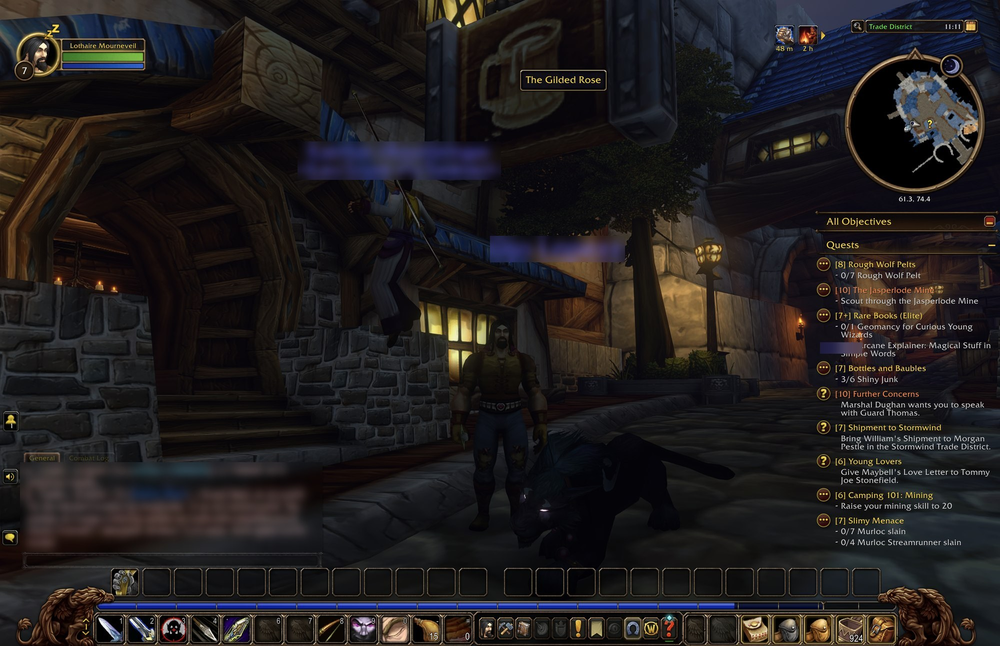
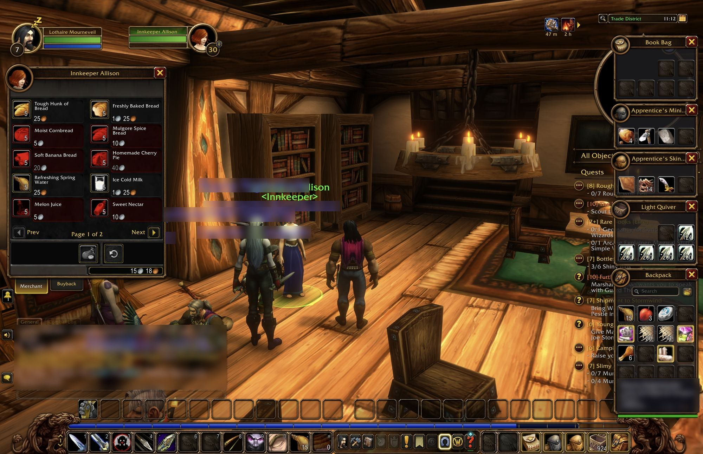

# Gilded Rose

This is the Gilded Rose kata in TypeScript.

## Getting started

Install dependencies

```sh
npm install
```

## Run the unit tests from the Command-Line

```sh
npm run test:jest
```

To run all tests in watch mode

```sh
npm run test:jest:watch
```


## Run the TextTest fixture from the Command-Line

_You may need to install `ts-node`_

```sh
npx ts-node test/golden-master-text-test.ts
```

Or with number of days as args:
```sh
npx ts-node test/golden-master-text-test.ts 10
```

You should make sure the command shown above works when you execute it in a terminal before trying to use TextTest (see below).


## Run the TextTest approval test that comes with this project

There are instructions in the [TextTest Readme](texttests/README.md) for setting up TextTest. [config.gr](texttests/config.gr) is already set up for this project, so you can run it with:

```sh
./start_texttest.sh
```

TextTest doesn't run on the newest Python releases, so the script picks a Python that can run it. Set `PYTHON` to choose one yourself.


## Acceptance testing

The author has visited the Gilded Rose and taste tested the inventory as part of acceptance testing during the WoW Forever launch weekend.






